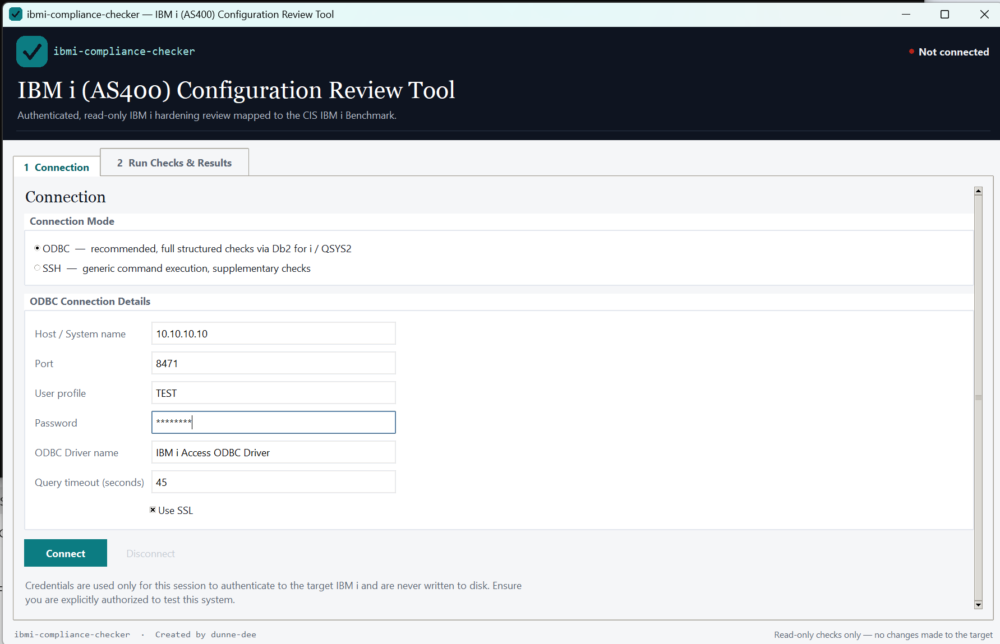

# ibmi-compliance-checker

A simple Windows tool that checks an IBM i (AS400) system against the **CIS IBM i Benchmark** and gives you a clear report.

- **Read-only.** It looks at settings. It never changes anything.
- **93 checks** covering system values, users, authorities, network and more.
- **Clear results.** Each check shows Pass, Fail, Review or Error, with the evidence, the command used and a recommendation.
- **Easy reports.** Export to HTML or CSV with one click.

> **Authorised use only.** Only run this against systems you have written permission to test.

---

## What you need

1. **Windows** with **Python 3.10 or newer**
2. The Python packages:
   ```
   pip install -r requirements.txt
   ```
3. The **IBM i Access ODBC Driver**. Install it from IBM's *Windows Application Package* (`IBMiAccess_v1r1_WindowsAP_English.zip`, then run `setup.exe`).
   To check it worked, open **ODBC Data Sources (64-bit)** and look for "IBM i Access ODBC Driver" on the Drivers tab.

---

## How to use it

1. Start the tool:
   ```
   python app.py
   ```
2. On the **Connection** tab, enter the host, user profile and password, then click **Connect**.
3. On the **Run Checks & Results** tab, click **Run Checks**.
4. Click any row to see the evidence, the command used and the recommendation.
5. Click **Export** to save the HTML or CSV report.

Results are also saved automatically to the `reports` folder.

---

## What the results mean

| Result | Meaning |
|--------|---------|
| **Pass** | The setting meets the benchmark. |
| **Fail** | The setting does not meet the benchmark. |
| **Review** | A person needs to check this one (it needs judgement). |
| **Error** | The check could not run (for example, no permission). |

---

## ODBC or SSH?

- **ODBC** (recommended): runs the full set of checks.
- **SSH**: a smaller set, mainly for reading config files.

---

## Good to know

- Each query times out after 45 seconds, so one slow check will not freeze the run.
- The evidence preview shows the first 15 rows, but the totals are always accurate.
- **The `reports` folder holds client data. Never commit it to GitHub.**

---

## Adding or editing checks

All checks live in `checks_config.json`. Copy an existing entry, change the query and the pass rule, and save. CIS numbers are used as references only.

---

## Files

| File | What it does |
|------|--------------|
| `app.py` | The window (GUI) |
| `checks_config.json` | The list of checks |
| `checks_engine.py` | Runs the checks and decides pass/fail |
| `connectors.py` | ODBC and SSH connections |
| `report_generator.py` | Builds the HTML and CSV reports |
| `requirements.txt` | Python packages needed |

---

Created by **dunne-dee**